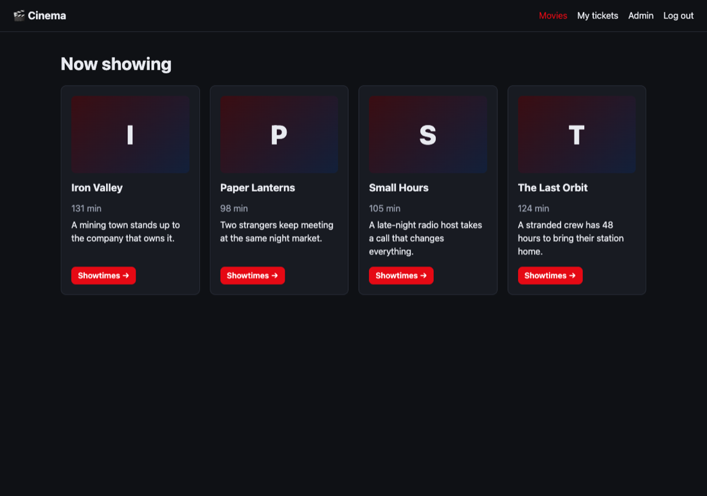
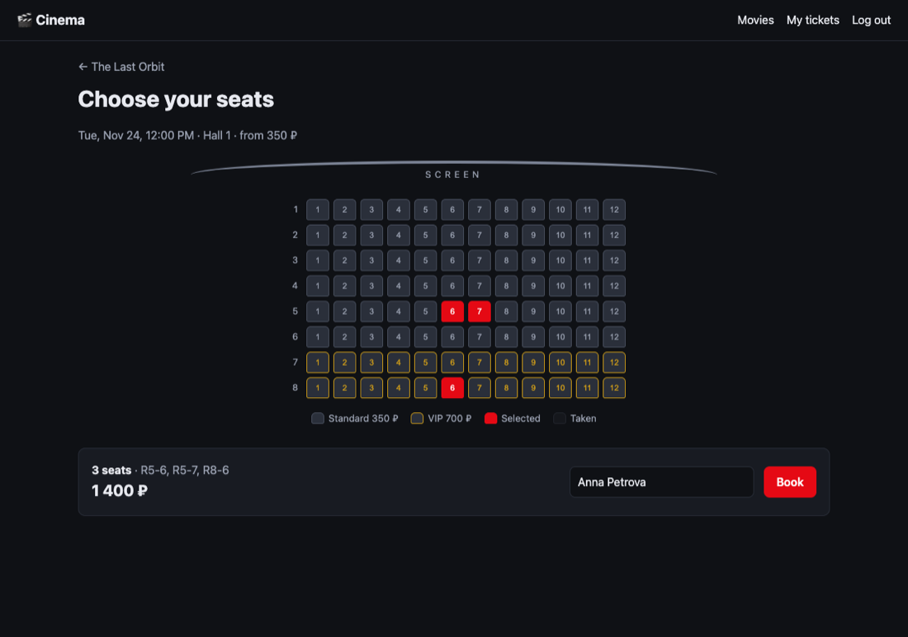
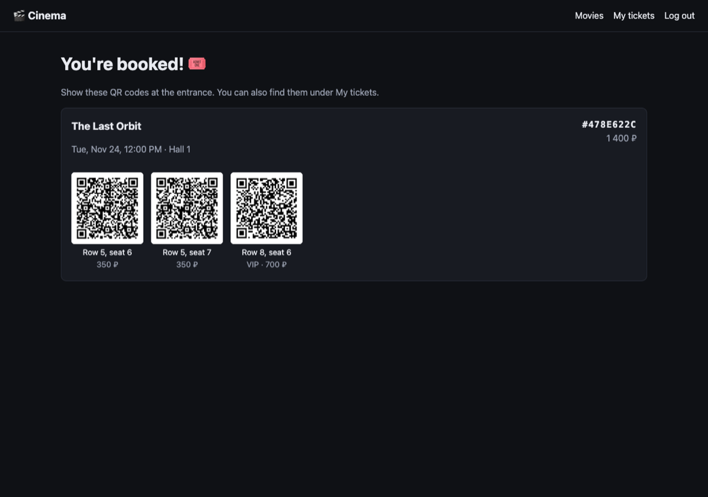
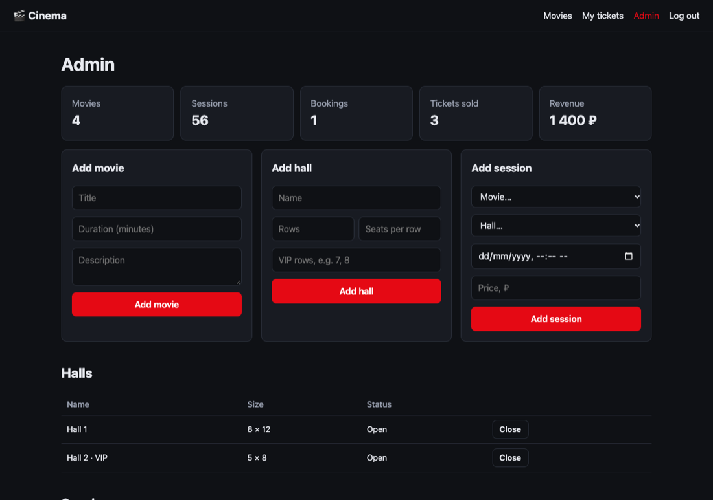

# Cinema Booking

A full-stack cinema ticket booking app built with FastAPI, PostgreSQL and React. Users pick seats on a live hall map
and get a QR-code ticket for each seat. Admins manage movies, halls, sessions and prices, and track bookings and revenue.

